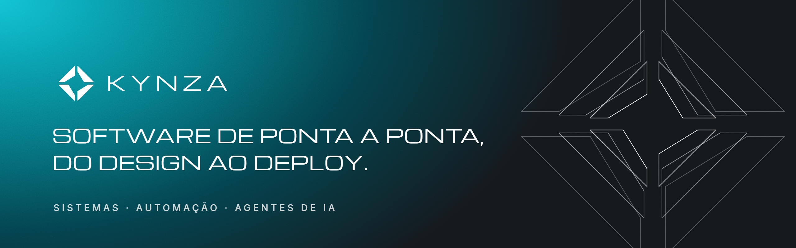

  

A **Kynza** é uma software house brasileira. Desenvolvemos sistemas sob medida, automações e agentes de inteligência artificial para empresas que querem operar com mais velocidade e menos trabalho manual.
O mesmo time acompanha o projeto do diagnóstico ao deploy.

## O que fazemos

| | |
|---|---|
| **Agentes de IA** | Atendimento no WhatsApp por texto e voz, com RAG, roteamento por intenção e integração ao CRM. O agente qualifica, responde e agenda 24 horas por dia. |
| **Automação de processos** | Integrações entre sistemas, APIs e fluxos que tiram da operação as tarefas repetitivas, as planilhas e o copia e cola. |
| **Sistemas e SaaS sob medida** | Plataformas web multi-tenant, com painéis, assinaturas, créditos e pagamentos. |
| **Integrações** | WhatsApp Cloud API, gateways de pagamento, CRMs, ERPs e APIs de terceiros. |

## Em números

- **+40** empresas atendidas
- **até 70%** menos tempo gasto em tarefas manuais
- **+40%** de performance em sites e sistemas

## Como trabalhamos

1. **Diagnóstico:** entendemos a operação, os gargalos e onde a tecnologia gera retorno de verdade.
2. **Design:** desenhamos a solução e a experiência junto com o seu time.
3. **Desenvolvimento:** entregas curtas, com validação a cada etapa.
4. **Deploy:** colocamos no ar com infraestrutura, monitoramento e segurança.
5. **Evolução:** acompanhamos os resultados e melhoramos continuamente.

## Stack

## Fale com a gente

[kynza.com.br](https://kynza.com.br) · [Instagram](https://instagram.com/kynzabr) · [LinkedIn](https://www.linkedin.com/company/kynzabr) · [contato@kynza.com.br](mailto:contato@kynza.com.br)

Kynza · Balneário Camboriú, SC · Brasil
